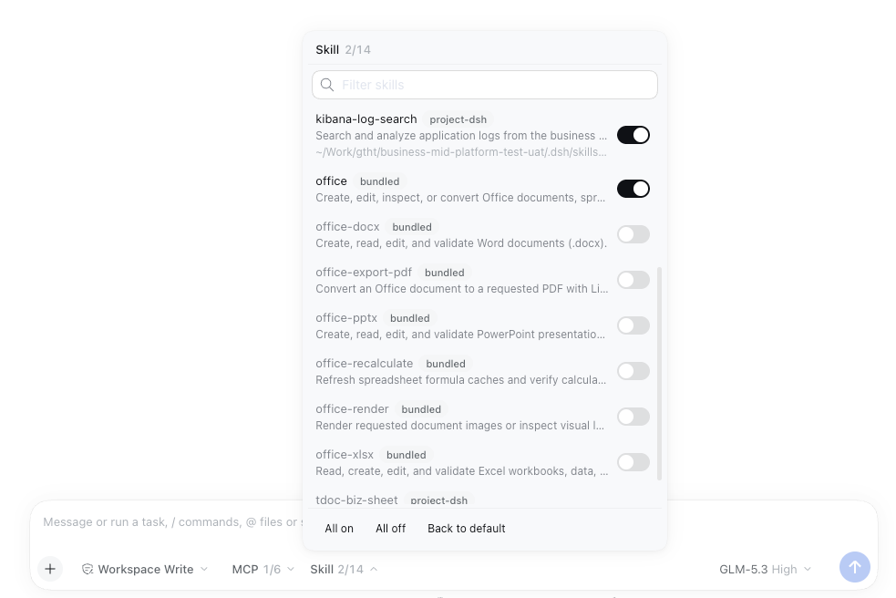

<div align="center">

# dsh-capability-scope

**Switch MCP servers, MCP tools, and skills per session from the DeepSeek Harness composer, and remember the choice per workspace**

[中文](README.zh-CN.md) · [Changelog](CHANGELOG.md) · [MIT](LICENSE)

[](https://www.npmjs.com/package/dsh-capability-scope)
[](LICENSE)
[](#compatibility)

</div>

> A community-maintained DeepSeek Harness (DSH) plugin, not an official DeepSeek product.

A profile tends to carry many MCP servers and skills, while a given project or session needs only some of them. The extra tools take up context and invite calls that should not happen. This plugin adds two buttons to the bottom of the composer, `MCP 3/12` and `Skill 4/5`. Open one to trim what the model can see in this session; the change applies at once and becomes that directory's default for next time.

## Features

- **MCP server switches**: every MCP server from the profile and the current agent preset, with connection state and origin. A switched-off server's tools are hidden from the session, calls to them are refused, and its instructions leave the system prompt. It only subtracts: the server process keeps running and other sessions are unaffected.
- **MCP tool filter**: drill into a server and tick the tools to keep. Until you do, the server's own `toolFilter` config applies. Tools the server adds later stay hidden until ticked.
- **Skill switches**: a switched-off skill leaves the model's skill catalog, the `skill` tool, and the composer's `/` menu, for this session only. The panel shows each skill's source (such as `project-dsh`, `user-dsh`, `bundled`), description, and folder.
- **Per-workspace memory**: every panel change is remembered as that directory's default, and the next session opened there starts the same way.
- **Preset per directory**: a blank session opened in a directory switches to the agent preset last selected there, or to the one your `rules` name.
- **Locked mode**: with `locked: true` the panel is read-only and the configuration alone decides, for centrally managed deployments.

## Screenshots

**Skill toggles:**



## Install

Requires DSH 0.2.x with the Web or Desktop profile. The command installs the
package from npm:

```sh
dsh plugin --profile web add dsh-capability-scope
```

Restart DSH. The `MCP` and `Skill` buttons appear at the bottom of the composer, to the right of the permission control. For Desktop, use `--profile desktop`.

Profiles without a Web UI (such as headless) can install it too: there is no panel, but directory memory and `defaultOff` still apply.

<details>
<summary>Mount from source (development)</summary>

Insert a row by absolute path in the profile's `cordis.patch.yml` (`$DSH_HOME/profiles/<profile>/cordis.patch.yml`). The browser half is found by walking up to this package's `package.json`:

```yaml
- insert:
    - id: dsh-capability-scope
      name: /absolute/path/to/dsh-capability-scope/src/index.mjs
```

</details>

## Usage

**MCP panel**

- One row per server: state dot, name, origin tag (`profile` / `preset` / `unlisted`), and the kept/total tool count in parentheses, or the state when the server cannot serve tools.
- Click `›` to open the server's tools and tick the ones to keep; **Reset** returns to the configured `toolFilter`.
- **All on / All off** at the bottom act only on the rows the filter shows; **Back to default** returns to `defaultOff`.

**Skill panel**

- Three lines per skill: name with source tag, description, and folder (home shortened to `~`; runtime skills have none). Hover for the full text.
- Switched-off skills stay listed, so they are one click away.

Lists longer than 13 rows get a filter box under the title: MCP matches server names; skills match name, description, folder, and source.

> [!NOTE]
> Changing a session that has already started changes the tools or skills the model sees, which invalidates the prompt cache and makes the next request cost more. Set things up before the first message when you can.

## Configuration

Every key is optional. To change one, override the row by id in the profile's own `cordis.patch.yml`. An override **replaces the whole config block**, so list every key you want:

```yaml
- id: dsh-capability-scope
  config:
    rules:                        # preset by path for directories with no memory (subdirectories included, longest match wins)
      - path: ~/work/payment-service
        preset: backend-tools
    defaultOff:                   # servers / skills off in directories with no memory
      mcp: [tdoc]
      skills: []
```

| Key | Default | Meaning |
|---|---|---|
| `rules` | `[]` | `{ path, preset }` list, used only for blank sessions with no remembered preset. `path` must be absolute (`~` allowed) and matches the directory and its subdirectories |
| `defaultOff.mcp` | `[]` | MCP servers (`serverName`) off by default in directories with no memory |
| `defaultOff.skills` | `[]` | Skills off by default in directories with no memory |
| `remember` | `true` | Remember panel changes and preset picks per directory. When off, changes last for the session only |
| `locked` | `false` | Read-only panel: writes answer 403 and directory memory is neither read nor written (`remember` counts as `false`). MCP tools follow `toolFilter`, switches follow `defaultOff` |
| `enforceGuard` | `true` | Besides hiding, also refuse calls to hidden tools |
| `memoryPath` | `.capability-scope.json` in the profile directory | Memory file; must be absolute |
| `echoToConsole` | `true` | Mirror diagnostics to stdout / stderr |

A few rules:

- **Directory memory matches the exact path**; a subdirectory counts as a directory with no memory. `rules` do cover subdirectories.
- **`defaultOff` is a deny list**: servers and skills added later start on.
- Presets are switched only for **blank top-level sessions**. Started sessions, subagents, sessions with an explicit preset (such as Creator mode), and sessions whose preset was changed by hand are left alone.

## How it works

| Capability | Mechanism |
|---|---|
| Hide MCP tools | `agent.ctx.tools.restrict({ deny })`, which masks tools inherited from the global layer and the preset scope; `agent.ctx.tools.guard()` refuses calls (resource tools by their `server` argument) |
| Drop server instructions | Empty same-name `mcp:<server>` prompt sections in the session layer, plus a restated `mcp-resource-servers` section |
| Switch off a skill | A same-name shadow skill in the session layer that neither model nor user can invoke; the skill registry merges nearest layer last, so the shadow wins |
| Refresh the `/` menu | After a skill switch, re-emit `agent-preset/selected` for the session's current preset so browsers drop its skill cache. Nothing is appended to the session and it is not remembered as the directory's preset |
| Memory | `.capability-scope.json` in the profile directory: per directory, the preset, off lists, tool allow-lists, and the description, folder, and source of switched-off skills (which the session's own view can no longer show) |

The panel reads with `GET /dsh-capability-scope/session?id=<sessionId>` and writes with `POST /dsh-capability-scope/session` (body: `id` plus one of `mcpOff` / `skillsOff` / `filter`).

## Compatibility

Developed and tested on DSH **0.2.0-rc.2**. `peerDependencies` declares `>=0.2.0-rc.2 <0.3.0-0`, so `dsh plugin add` refuses other runtimes. Node.js ≥ 20.

The plugin reads several host internals: `agentPresets.definitions` (preset MCP rows and scope), `agentPresets.serviceFor / composedPreset / select / defaultId`, `ctx.tools.schemas / restrict / guard`, `skills.register / snapshot`, `sessionProjections.stateOf`, and `mcpResources.layers`. When they change, it degrades instead of failing to mount:

- `definitions` unreadable: preset servers show as `unlisted` without connection state; tools are still attributed by name.
- The host stops dropping the skill cache on `agent-preset/selected`: skill switches still apply, but the `/` menu updates only in a new session.

## Development

```sh
npm test          # smoke tests against a fake host; no dependencies to install
npm run pack:check
```

| Path | Contents |
|---|---|
| `src/index.mjs` | Host half: session state, tool restriction, shadow skills, preset choice, HTTP API |
| `src/memory.mjs` | Workspace memory file |
| `src/names.mjs` | MCP public tool names and `toolFilter` matching (same rules as `dsh-mcp-client`, locked by `test/golden-names.json`) |
| `lib/client.js` | Browser half: composer buttons and panels (no build step) |
| `cordis.patch.yml` | Bundle patch used by `dsh plugin add` |

Issues and pull requests are welcome.

## License

[MIT](LICENSE)
